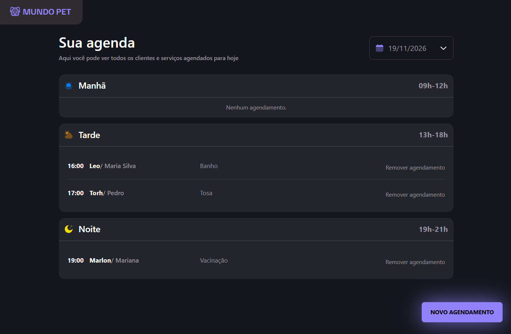
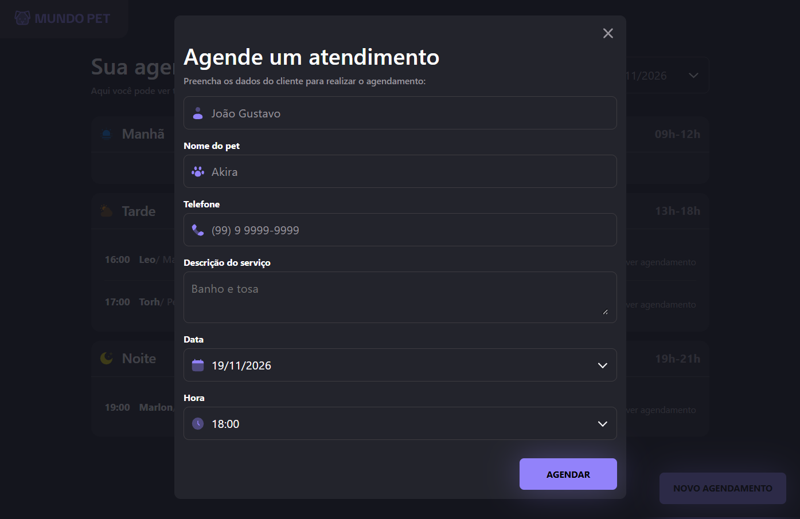

#  Mundo Pet — Sistema de Agendamento

Aplicação web desenvolvida para facilitar o gerenciamento de agendamentos de um pet shop, permitindo organizar atendimentos, consultar horários disponíveis, cadastrar novos serviços e cancelar agendamentos.

O projeto foi desenvolvido utilizando JavaScript, HTML e CSS, com integração a uma API local por meio do JSON Server.

<p align="center">
  
</p>

## 📌 Demonstração

- **Documentação e instruções de execução:** [Acessar GitHub Pages](https://lazaro277.github.io/agendamento-petshop/)
- **Código-fonte:** [GitHub — agendamento-petshop](https://github.com/Lazaro277/agendamento-petshop)

> A aplicação utiliza uma API local. O GitHub Pages hospeda a documentação do projeto, não a aplicação funcional.

## ✨ Funcionalidades

- **Visualização de agendamentos:** consulta dos atendimentos cadastrados para uma data específica.
- **Organização por períodos:** separação dos agendamentos em manhã, tarde e noite.
- **Ordenação cronológica:** exibição dos atendimentos em ordem de horário dentro de cada período.
- **Cadastro de agendamentos:** formulário com informações do tutor, do pet, telefone, descrição do serviço, data e horário.
- **Consulta de horários disponíveis:** horários ocupados e horários que já passaram não são disponibilizados para seleção.
- **Cancelamento de agendamentos:** possibilidade de remover atendimentos mediante confirmação.
- **Notificações:** mensagens de sucesso e erro para informar o resultado das operações.
- **Seleção de datas:** consulta e cadastro de atendimentos em diferentes datas.

## 🖥️ Interface

### Tela principal

<p align="center">
  
</p>

### Novo agendamento

<p align="center">
  
</p>

## 🛠️ Tecnologias utilizadas

| Tecnologia | Utilização |
|---|---|
| HTML5 | Estrutura da aplicação |
| CSS3 | Estilização e responsividade |
| JavaScript | Lógica e funcionalidades |
| Webpack | Empacotamento e servidor de desenvolvimento |
| Babel | Transpilação de JavaScript |
| Day.js | Manipulação de datas e horários |
| JSON Server | API REST local para armazenamento dos agendamentos |
| Bootstrap 5 | Recursos de interface e componentes |
| Bootstrap Icons | Ícones da interface |

## ⚙️ Como executar o projeto

Para executar a aplicação em sua máquina, é necessário instalar as dependências e iniciar dois servidores: o JSON Server e o servidor de desenvolvimento do Webpack.

### 1. Pré-requisitos

Antes de começar, você precisa ter instalado:

- [Node.js](https://nodejs.org/) — preferencialmente a versão LTS.
- npm — instalado junto com o Node.js.
- [Git](https://git-scm.com/) — para clonar o repositório.
- Um editor de código, como o [Visual Studio Code](https://code.visualstudio.com/).

Para verificar se Node.js e npm estão instalados, execute:

```bash
node -v
npm -v
```

### 2. Clone o repositório

Abra o terminal e execute:

```bash
git clone https://github.com/Lazaro277/agendamento-petshop.git
```

Entre na pasta do projeto:

```bash
cd agendamento-petshop
```

### 3. Instale as dependências

Execute o comando:

```bash
npm install
```

Aguarde a instalação de todas as dependências necessárias.

### 4. Inicie o JSON Server

Abra um terminal na pasta do projeto e execute:

```bash
npm run server
```

Esse comando inicia a API local na porta `3333`.

A API ficará disponível em:

```text
http://localhost:3333
```

Mantenha esse terminal aberto durante a utilização da aplicação.

### 5. Inicie a aplicação

Abra uma segunda janela de terminal, também na pasta do projeto, e execute:

```bash
npm run dev
```

O Webpack iniciará o servidor de desenvolvimento na porta `3000`.

Acesse a aplicação pelo navegador:

```text
http://localhost:3000
```

**Importante:** os dois servidores precisam permanecer em execução para que todas as funcionalidades funcionem corretamente.

## 📂 Estrutura do projeto

```text
agendamento-petshop/
│
├── docs/
│   ├── assets/
│   │   ├── tela-principal.png
│   │   └── novo-agendamento.png
│   └── index.html
│
├── src/
│   ├── assets/
│   │
│   ├── libs/
│   │
│   ├── modules/
│   │   ├── form/
│   │   └── schedules/
│   │
│   ├── services/
│   │
│   ├── styles/
│   │
│   ├── utils/
│   │
│   └── main.js
│
├── index.html
├── server.json
├── package.json
├── package-lock.json
└── webpack.config.js
```

### Organização dos principais diretórios

- `src/modules/`: contém os módulos responsáveis pelas funcionalidades de formulário e gerenciamento dos agendamentos.
- `src/services/`: concentra as operações de comunicação com a API.
- `src/styles/`: contém os arquivos CSS da aplicação.
- `src/utils/`: reúne funções utilitárias utilizadas em diferentes partes do projeto.
- `src/assets/`: armazena imagens, ícones e outros recursos visuais.
- `server.json`: arquivo utilizado pelo JSON Server para armazenar os agendamentos localmente.
- `docs/`: contém a documentação publicada pelo GitHub Pages.

## 🗄️ API e armazenamento

O projeto utiliza o JSON Server para simular uma API REST e realizar operações de cadastro, consulta e exclusão de agendamentos.

A configuração da URL da API está localizada em:

```text
src/services/api-config.js
```

Atualmente, a aplicação utiliza:

```javascript
export const apiConfig = {
  baseURL: "http://localhost:3333",
}
```

Os dados dos agendamentos são armazenados localmente no arquivo `server.json`.

**Observação:** os dados são utilizados no ambiente local. O projeto não possui uma API hospedada externamente nem um banco de dados remoto.

## 📜 Scripts disponíveis

Os seguintes comandos estão configurados no `package.json`:

| Comando | Descrição |
|---|---|
| `npm install` | Instala as dependências |
| `npm run dev` | Inicia o servidor de desenvolvimento |
| `npm run server` | Inicia o JSON Server |
| `npm run build` | Gera a versão de produção na pasta `dist` |

## 🎯 Objetivo do projeto

Este projeto foi desenvolvido com o objetivo de praticar e consolidar conhecimentos em desenvolvimento web, especialmente na utilização de JavaScript para manipulação do DOM, organização de módulos, consumo de APIs e gerenciamento de dados.

Também foi uma oportunidade de trabalhar com ferramentas de desenvolvimento como Webpack, Babel e JSON Server, aplicando conceitos de organização e separação de responsabilidades no código.

## 👨‍💻 Desenvolvedor

**Lázaro Messias**

Estudante de Engenharia de Software e desenvolvedor em formação, interessado em desenvolvimento de software e tecnologias web.

- [GitHub](https://github.com/Lazaro277)
- [LinkedIn](https://www.linkedin.com/in/lazaro-messias)

---

<p align="center">
  Desenvolvido por <strong>Lázaro Messias</strong> 🐾
</p>
